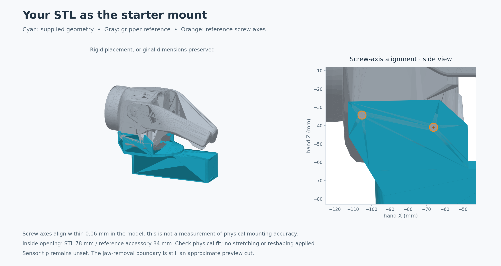
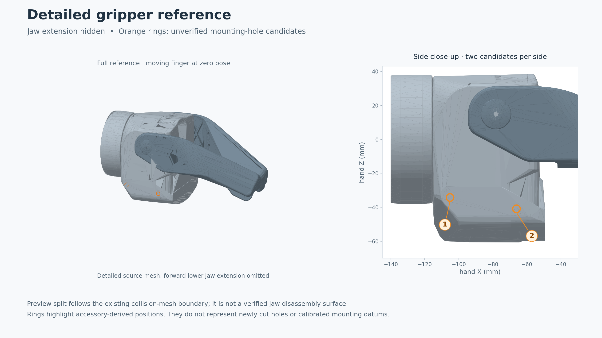

# Fault detector mount creator

A small, standalone desktop editor for Spot sensor mounts. It starts with a
bundled mount aligned to the gripper screw axes. Move or replace the STL, add
boxes or other meshes, and mark the sensor tip and sensing direction. A single `.sensorhead` file preserves the
collision mesh, transforms, and editable source parts.

This first milestone runs independently of ROS. Integration with the sensor
registry, TF, and MoveIt belongs to `fault_detector_spot` and is not implemented
here.

## Run

Python 3.10 or newer, NumPy, PyQt5, and VTK are required. From this repository:

```bash
python3 -m venv .venv
source .venv/bin/activate
python -m pip install -e .
mount-creator
```

If the dependencies are already installed, `python3 main.py` also works. The
desktop application needs a working graphical display and OpenGL. Press Ctrl+C
in its launch terminal to exit immediately, discarding unexported changes. Development
checks use Python 3.10, NumPy 1.21, PyQt5 5.15, and VTK 9.1.

## First workflow

1. Start from the preloaded **Starter mount**. **New** restores a fresh copy.
   Use **Remove selected part** to start empty, **Add box** to extend it, or
   **Import STL** to add another mesh. Import asks for millimetres, metres,
   or inches; check the displayed part size before continuing.
2. Set box dimensions and each part's position and rotation. **Whole mount**
   places the complete assembly relative to Spot's hand reference.
3. Open **Sensor tip**, click the initial tip position, then adjust its distance
   from reference surfaces (see below). Check that the red sensing arrow faces
   the inspected surface. **Use clicked tip face for sensing direction** aligns
   it with the picked face; turn this off to preserve the existing direction.
4. **Export head** writes a `.sensorhead` file. **Open head** restores its parts,
   dimensions, placement, and tip for further editing.

The starter STL retains its original shape: its dimensions are read-only, but
its position and rotation are editable. To change its holes, wall thickness or
other built-in features, edit it in CAD and replace the mesh. Added boxes have
editable dimensions. The sensor tip starts unset; choose its actual sensing
point before exporting.

Moving the whole mount carries its tip. Editing the tip does not move the mesh.
Moving an individual part changes only that part, so check the tip again when
changing the assembly. Length controls use millimetres; file coordinates use
metres. Rotations in the UI use roll/pitch/yaw degrees; exported poses use xyzw
quaternions.

The preview arrows follow the controls being edited. **Mount X/Y/Z** match
selected-part positions, **Hand X/Y/Z** match whole-mount positions, and
**Part X/Y/Z** match selected-part sizes. Click a field to show its coordinate
frame. For the starter mount, Mount Y points up and Mount Z sideways; Hand Z
points up because the mount's original STL axes are rotated relative to the hand.
The Sensor tip tab shows the reference part's axes while measuring a surface.

## Position a tip from physical measurements

1. In **Sensor tip**, choose **Pick sensor tip on mount** and click its initial
   position on a mount surface. This places the tip immediately.
2. Choose **Pick reference surface** and click the flat face you measured from
   on the real mount. Any authored part can be selected directly. The chosen
   plane is highlighted yellow; selecting it does not move the tip.
3. Choose **X**, **Y** or **Z** and read the signed distance in millimetres. The
   editor initially chooses the axis most perpendicular to that face. Axes
   parallel to the plane are disabled because they cannot intersect it.
4. Type the measured distance and press Enter or leave the field. The tip moves
   immediately along only that axis, keeping its other two coordinates and
   sensing direction. Positive distances follow the colored arrow; negative
   distances go the other way. For example, on a top face perpendicular to Z,
   entering +5 places the tip 5 mm above that plane along +Z.
5. Pick another reference surface and repeat until the placement matches your
   measurements. Check the red sensing arrow before export.

X/Y/Z belong to the reference part's original geometry, including its current
rotation, not the camera view or Spot's hand. On the starter STL, X runs forward,
Y upward and Z across the mount toward negative hand Y. Rotating the whole mount
carries the ruler and tip together without changing the measured distance.

The ruler follows the selected axis from the surface plane to the tip. For an
angled face, this is an axis distance rather than the perpendicular distance.
The plane extends beyond the visible face; the intersection may lie outside
its edges. On a flat face the result is independent of where you click. On a
curved STL surface, the clicked triangle supplies a local plane, so use a flat
face as the reference for precise physical measurements. Accuracy still depends
on the source mesh and your physical measurements.

Each edit operates on the current tip position; previous distances are not
locked as constraints. On angled faces, adjusting another axis can change a
previous measurement, so recheck it as needed. Picking a new tip position refreshes
the current readout. Changing the reference or measurement axis is read-only.

The measurement guides never enter exported collision geometry. The reference
is temporary: moving/resizing a part, removing the reference part, or opening or
creating a head clears it. Export saves the resulting tip pose. After reopening,
pick a reference surface again to recheck its dimensions.

## Starter mount

The supplied Shapr3D STL is bundled unchanged (3,360 triangles), interpreted in
millimetres, and placed with a rigid transform. Its four screw axes match the
reference candidates within 0.046 mm in the model. The mesh remains in its source
frame; **Whole mount** holds the alignment to `hand`, applied once on display and
recorded in the export.

This numerical fit does not establish physical accuracy. The STL has a 78 mm
inside opening, while the reference accessory suggests 84 mm. Its plates overlap
retained jaw material in the current approximate preview. That material may be
part of the jaw being replaced; check the actual assembly before treating the
alignment as a calibrated datum. The STL is not stretched to conceal this
difference. Alignment details are in `assets/starter_mount.json`.



## Reference and current limits

The viewport uses the more detailed Spot visual meshes at the existing `hand`
datum. The forward lower-jaw extension is hidden by default; **Show lower-jaw
extension** restores it. The source mesh fuses the jaw and wrist, so the split is
an approximate display cut, not a verified disassembly boundary. The rear wrap
under the wrist remains visible. The finger is shown in its closed reference pose.

Four orange rings highlight mounting-hole axes fitted from a lower-jaw camera
accessory mesh. These are the four locations identified for the sensor mount;
their numerical positions remain model-derived. The stock mesh does not
establish precise circular bores there. The rings are lifted
1 mm outward for visibility without changing the stored candidate coordinates.
**Highlight candidate mounting holes** toggles the overlay. Neither the detailed
reference meshes nor the highlights enter exported collision geometry. See
[asset provenance](mount_creator/assets/ASSET_SOURCES.md) for sources and transforms.



The exact physically removed jaw components have not been verified. Files carry
`mounting_template_verified: false`; they are development definitions, not an
approved runtime attachment profile. The eventual robot importer must require a
verified compatible template before activation.

This milestone provides numeric placement, STL import, boxes, surface-based
measurement guides, immediate tip distance adjustment, direct tip picking, and
export/reopen. Cylinders, drag handles, guided landmark alignment, undo/redo, and
collision-envelope padding remain future work. Export uses the nominal mesh with
zero extra clearance. Imported meshes must be closed, consistently wound and
nondegenerate. Structural validation does not detect every self-intersection or
perform Boolean unions of overlapping parts.

Limits are 200,000 total collision triangles, 128 parts, 32 MiB per STL/archive,
and 128 MiB of expanded archive data. These are initial resource bounds, not
performance guarantees. User file parsing and mesh validation run outside the UI
thread; the small bundled starter is loaded when creating a new document. A failed open or export preserves the previous document/file.

The 0.01 mm numerical round-trip test is separate from the physical 1 mm tip
accuracy target. Physical accuracy needs measured mounting references, assembly
repeatability, and validation on the real head.

## Code layout

| File | Responsibility |
| --- | --- |
| `geometry.py` | Rigid poses, box geometry, STL data, mesh checks. |
| `document.py` | The editable document and its parts. |
| `starter.py` | A fresh starter document from the bundled STL and alignment. |
| `bundle.py` | Bounded, validated, atomic `.sensorhead` file operations. |
| `viewport.py` | VTK actors, camera, and surface picking. |
| `app.py` | Qt controls and explicit edits to the document. |

The code uses ordinary functions and dataclasses, one document owner, and direct
method calls. Keep units explicit, validate at file boundaries, and keep rendering
out of geometry calculations. Add an abstraction only when a concrete repeated
responsibility needs it; prefer a readable function over a framework or hierarchy.

## File format

`.sensorhead` is a ZIP containing `manifest.json` and `collision.stl`. The manifest
records schema version 1, template identity, units, the mesh hash, `hand_to_geometry`
and `hand_to_probe`. Mesh vertices are local to the geometry frame; placement is
applied once. The editor also writes `authoring.json` and normalized source STLs
to preserve editable parts. A runtime-only package without authoring data opens
as a single mesh. Inconsistent authoring and collision data are rejected.

The package has no sensor registry ID or acquisition settings. A later importer
will apply geometry and tip together to the sensor entry selected in the Spot UI.

## Offline checks

```bash
python3 -m unittest discover -s tests -v
```

Tests cover pose conventions, unit conversion, mesh validation, archive limits,
failed-write preservation, starter screw-axis alignment, measured offsets in
rotated part frames, exact reference-plane geometry, and export/reopen precision. UI tests use offscreen Qt
with a generic VTK render window, without rendering or connecting to a robot.
They check controls and scene data, not the desktop OpenGL rendering path.
